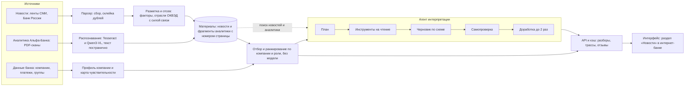
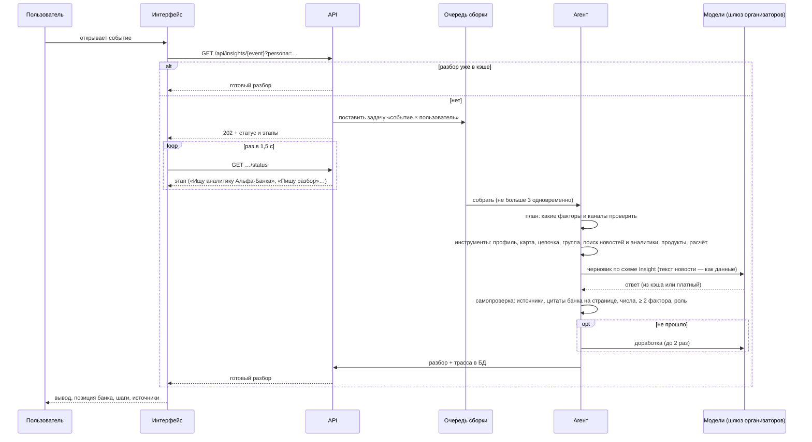
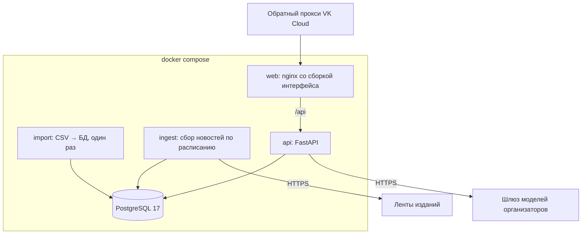

# Архитектура

Сервис — раздел «Новости» внутри макета интернет-банка. Данные идут по цепочке: **источники → парсер → разметка и отсев
→ профиль и карта чувствительности → ранжирование → агент → API → интерфейс**. Короткая версия схемы — в
[README](../README.md); здесь — подробнее: компоненты, как собирается разбор, как устроен запуск и стенд.

## 1. Компоненты и поток данных

| Компонент | Что делает | Модель? | Код |
|---|---|---|---|
| **Парсер новостей** | читает ленты из `sources.toml`, нормализует, склеивает дубли (одна ссылка из разных лент; один сюжет у разных изданий в окне 48 часов), забирает заголовок, лид, ссылку и картинку; полный текст — только там, где условия издателя разрешают | нет | `apps/ingest` |
| **Разметка** | словари `dictionaries.toml`: факторы (ставка, курс, сырьё…), отрасли ОКВЭД с силой связи 0–1 и доказательством, тип события, регионы, страны, ожидания рынка. Не деловое отсеивается; спорные случаи решает дешёвая модель с кэшем | Gemma (по необходимости) | `apps/ingest/tagging` |
| **Распознавание аналитики** | PDF-сканы → текст постранично: Tesseract для текста, Qwen3-VL для таблиц; результат кэшируется, фрагменты связаны с номерами страниц | Qwen3-VL (один раз) | `apps/ingest/analytics` |
| **Импорт данных банка** | CSV → PostgreSQL: компании, группы, платежи без самопереводов, связи физлиц | нет | `apps/api/importer.py` |
| **Профиль и карта чувствительности** | признаки компании с происхождением; сила каждого фактора по правилам `factors.toml`, канал и доказательства; цепочка через покупателей и поставщиков, влияние на группу | нет | `apps/api` |
| **Отбор и ранжирование** | оценка события = сила связи × чувствительность × вес роли × свежесть × качество источника; разложение оценки хранится; вывод для ленты формулируют правила, верх ленты — дешёвая модель с проверкой чисел | дешёвая модель для верха | `apps/api/ranking.py`, `takeaway*.py` |
| **Агент интерпретации** | свой цикл без агентных фреймворков: план → инструменты → черновик по схеме → детерминированная самопроверка → до двух доработок | да | `apps/api/agent` |
| **Клиент моделей** | модель по шагу из конфига, повторы, проверка ответа по схеме, дисковый кэш, журнал вызовов, суточный стоп-кран | — | `apps/api/llm` |
| **API** | FastAPI; все экраны читают только его; схема — [openapi.json](openapi.json) | — | `apps/api` |
| **Интерфейс** | React + TypeScript, макет банка с разделом «Новости» | — | `apps/web` |

## 2. Как собирается разбор

- **Разборы заранее.** Планировщик ставит в очередь разборы «важного» из верха ленты тестовых пользователей в своём
  бюджете; лента, неделя и карта кэшируются на 15 минут и прогреваются в фоне. Тестовый пользователь открывает готовое.
- **Самопроверка — не модель.** Это код: у фактов и позиции банка есть источники; выдержка факта находится в тексте
  новости; цитата банка — в распознанном тексте указанной страницы; числа есть в данных или источниках; суммы в рублях
  пишет только расчётный инструмент; учтено не меньше двух факторов или каналов; роль отражена; нет контрагентов вне
  цепочки. Не прошедшее после доработки убирается из разбора, в `quality.warnings` — чего не хватило.
- **Трасса.** Каждый шаг (план, вызов инструмента с найденными источниками и признаками, обращение к модели с токенами
  и стоимостью, проверка, доработка) записан: `GET /api/traces/{id}`, в интерфейсе — «Как получен вывод».

## 3. Принцип «интерфейс = функция состояния»

Интерфейс ничего не придумывает: любой экран — результат запроса к API. Состояние — данные банка, материалы, готовые
разборы, отзывы, подключённые источники, «Мои числа». Нет заготовленных экранов под демо: новая новость или другой
пользователь меняют состояние, и лента, карта и разбор становятся другими. Это же делает проверяемым любой вывод:
открыв «Как получен вывод», можно пройти от экрана к данным, которые его породили. Тестовые данные в интерфейсе
остались только в тестах.

## 4. Запуск и развёртывание

- Локально: `docker compose up --build` поднимает базу, импорт, парсер и API; интерфейс — `apps/web` (`npm run dev`) или
  образ `web` в наложении `deploy/compose.server.yaml`.
- Стенд: ВМ VK Cloud, образы собираются локально и переносятся архивом; порты наружу не публикуются, веб доступен только
  обратному прокси. Подробно — [deploy/README.md](../deploy/README.md).
- Секреты (ключ моделей) — только в `.env` на сервере; в браузер и в журнал не попадают.
