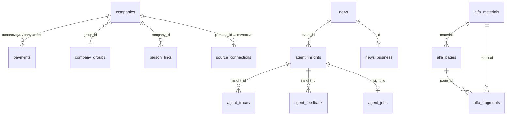

# Модель данных

Одна база PostgreSQL 17. Таблицы делят три владельца: **импорт данных банка** (`apps/api`, `db.py`), **парсер материалов**
(`apps/ingest`, `db/schema.py`) и **агент** (`apps/api`, `agent/store.py`). Версии схем раздельные: миграция одной группы
не трогает таблицы другой (`schema_meta`: ключ `version` — у API, `search_version` — у парсера). Файлы схем — источник
правды; ниже — их описание.

## 1. Данные банка (кейс) — `apps/api/src/api/db.py`

Загружаются один раз из трёх CSV (`df_Uid_data_hack.csv`, `df_Uid_payment_hack.csv`, `df_Fid_Uid_link_hack.csv`); повторно —
только при смене файла или `IMPORT_FORCE=true`. Что отбрасывается при импорте — в [README](../README.md), раздел «Данные
компаний».

| Таблица | Что хранит | Ключевые поля |
|---|---|---|
| `companies` | компания: отрасль, масштаб, продукты банка, внешняя торговля, группа, регион | `id` (`SYNTHETIC_U`), `okved_code`, `okved_class` (двузначный класс, считается при импорте), `client_type` (CLIENT / PROSPECT / CLOSE_CLIENT), флаги продуктов `rko`, `guarantee`, `credit`, `leasing`, `deposit`, `salary_project`, `factoring`, `fts_flag` и `fts_countries`, `revenue` (2025; заглушка 1000 → «нет данных»), `group_id`, `region`, `city`, `duplicates` |
| `company_groups` | группа: выручка как сумма известных выручек участников, число участников и клиентов | `group_id`, `revenue`, `size`, `clients` |
| `payments` | пары «плательщик → получатель»: сумма и число операций с 1 января | `payer`, `beneficiary`, `amount`, `payments`; индексы по обеим сторонам; самопереводы в расчёты не входят |
| `person_links` | связи обезличенных физлиц с компаниями (город и регион обслуживания юрлица) | `person_id`, `company_id`; в API и в модель **не отдаются** |
| `imported_files` | что и когда загружено: подпись файла, строк прочитано, загружено, пропущено | `file`, `signature`, `rows_*` |
| `schema_meta` | версия схемы | `key`, `value` |

Пользовательские таблицы API (импорт их не пересоздаёт):

| Таблица | Что хранит |
|---|---|
| `source_connections` | какой пользователь подключил или отключил источник из каталога (`state`: `on` / `off`) |
| `user_inputs` | «Мои числа» пользователя для расчёта в рублях: долг, тип ставки, валютные закупки, топливо (`data` — JSON) |

Тестовые пользователи (роль + компания) в таблицы не входят: они строятся кодом из крупных клиентов по правилам
`apps/api/src/api/personas.py`.

## 2. Материалы — `apps/ingest/src/ingest/db/schema.py`

| Таблица | Что хранит | Ключевые поля |
|---|---|---|
| `news` | новость: заголовок, издатель, ссылка, дата, лид, полный текст (там, где условия источника разрешают), разметка | `id` (`src:news:…`), `tags` (JSON: факторы и отрасли с силой связи и доказательствами), `factors[]`, `okved[]`, `expectations` (ожидания рынка из лида), `also_reported_by` (склеенные дубли), `origin` (`feed` — лента, `user` — «своя новость»), `reliability`, `image_url`, полнотекстовый `tsv` |
| `news_business` | кэш ответа модели «деловая ли новость» для случаев, которые словари не решили | `id`, `business`, `model` |
| `news_image_stubs` | «картинки-заглушки» издателей (логотип, картинка для соцсетей), чтобы не показывать их как иллюстрации | `publisher`, `image_url` |
| `alfa_materials` | материал аналитики Альфа-Банка: название, файл, дата, число страниц, признак устаревшего (`stale`) | `id` (`src:alfa:<материал>`) |
| `alfa_pages` | страница материала целиком: текст двух способов распознавания — Tesseract (`ocr_text`) и Qwen3-VL (`vlm_text`); нужны для сверки цитат, наружу не отдаются | `id` (`src:alfa:<материал>#p<N>`), `material`, `page` |
| `alfa_fragments` | фрагмент страницы для поиска, с уверенностью распознавания и разметкой | `id` (`src:alfa:<материал>#p<N>-<n>`), `page_id`, `ocr_engine`, `factors[]`, `tsv` |
| `search_loads` | что и когда загружено в поиск (подпись файла) | `name`, `signature` |

Поиск — встроенный полнотекстовый PostgreSQL с русской морфологией; «е» и «ё» приводятся к одному виду. Эмбеддингов нет:
замер на тестовых запросах показал, что для нашей задачи достаточно полнотекстового.

## 3. Агент — `apps/api/src/api/agent/store.py`

| Таблица | Что хранит |
|---|---|
| `agent_insights` | готовая карточка (JSON по контракту `Insight`) для пары «событие × пользователь», контекст, стоимость в рублях, время; **кэш разборов** |
| `agent_traces` | трасса сборки: шаги (план, инструменты, модели, токены и стоимость, проверки, доработки) и человеческое резюме |
| `agent_feedback` | отзыв «полезно / не полезно»: причина (`not_relevant`, `wrong_facts`, `too_general`, `no_bank_view`, `unclear` или своя), комментарий |
| `agent_jobs` | фоновая сборка: очередь, этап, статус `queued` / `running` / `done` / `failed`; после перезапуска API незаконченные задачи честно помечаются `failed` |

## 4. Не в базе

| Что | Где | Зачем |
|---|---|---|
| Кэш ответов моделей | диск, том `llmcache`; ключ — SHA-256 запроса (модель, сообщения, параметры, схема ответа) | тот же запрос не оплачивается дважды, ответы воспроизводимы |
| Журнал вызовов моделей | файл `LLM_JOURNAL`: время, шаг, модель, токены, стоимость, из кэша или нет; ключ и тексты запросов не пишутся | учёт бюджета и аудит; суточный расход восстанавливается из него при старте |
| Кэш картинок новостей | диск, `IMG_CACHE_DIR`, до 2 000 файлов | прокси картинок |
| Кэш ленты, недели и карты | память API, 15 минут, прогрев демо-пользователей | быстрый ответ без пересчёта |
| Распознанная аналитика | `data/raw/derived/` (страницы, фрагменты, кэш распознавания) | повторный запуск не обращается к моделям |
| Снимок новостей | `data/demo/news_snapshot.jsonl` | сервис не остаётся без новостей, если ленты недоступны |

## 5. Контракт ответов

Схемы запросов и ответов — в [docs/openapi.json](openapi.json) (выгрузка из `/api/openapi.json`) и в коде
`apps/api/src/api/contract.py`. Главные модели:

- `CompanyProfile` — признаки компании с происхождением (`data`, `estimate`…), группа, платежи по отраслям контрагентов
  с покрытием, чего не хватает (`missing`);
- `Insight` — разбор по паре «событие × пользователь»: вывод, «почему», действия, позиция банка, утверждения
  (`Statement`: текст, происхождение `fact` / `bank` / `ai` / `hypothesis` / `data` / `estimate` / `offer`, ссылки на
  источники и признаки, уверенность), качество (`checks_passed`, `warnings`);
- `Source` — первоисточник: новость или фрагмент аналитики банка с файлом и страницей;
- `Trace` — трасса разбора.
