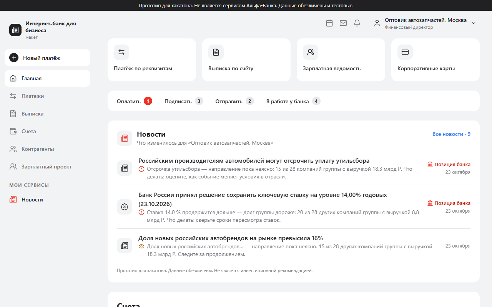
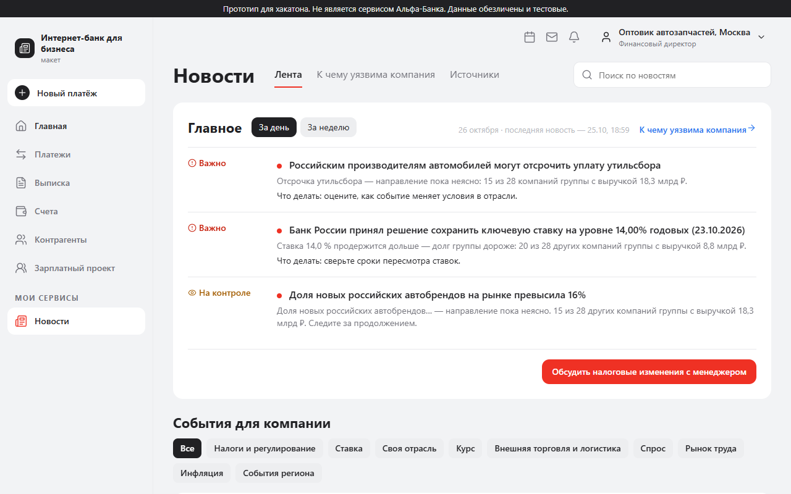
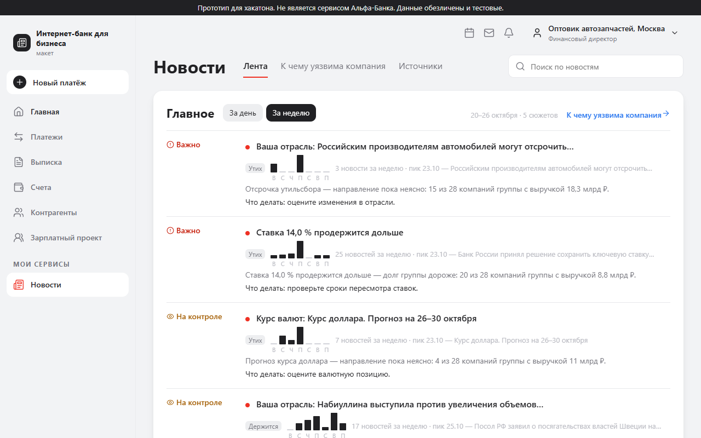
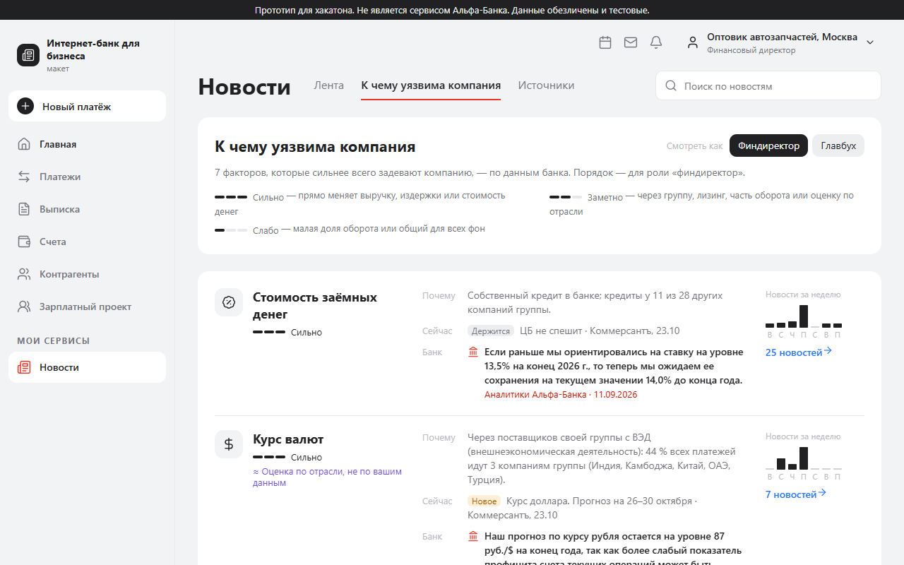
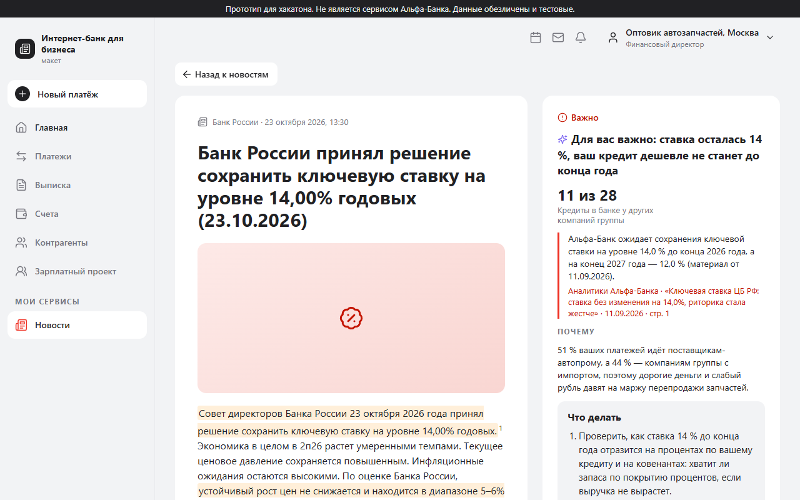
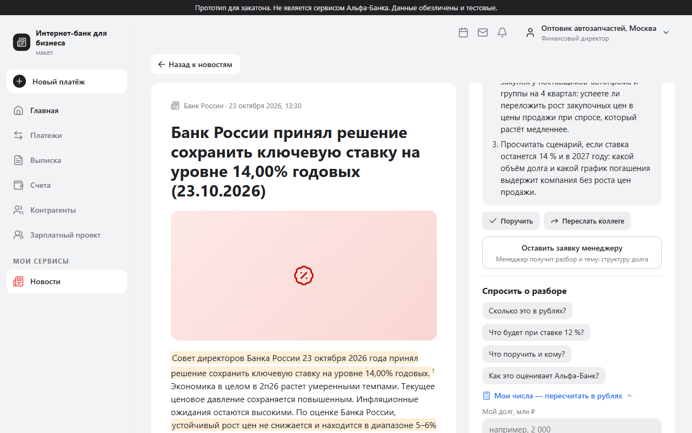
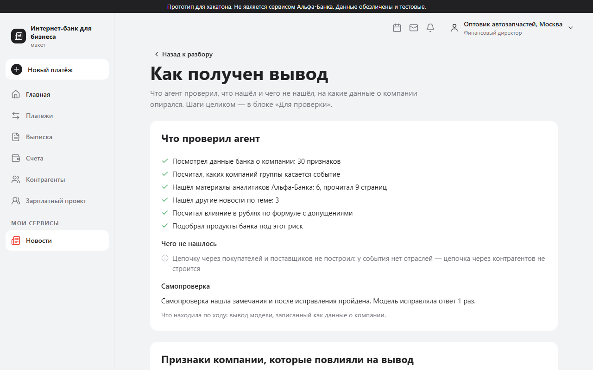
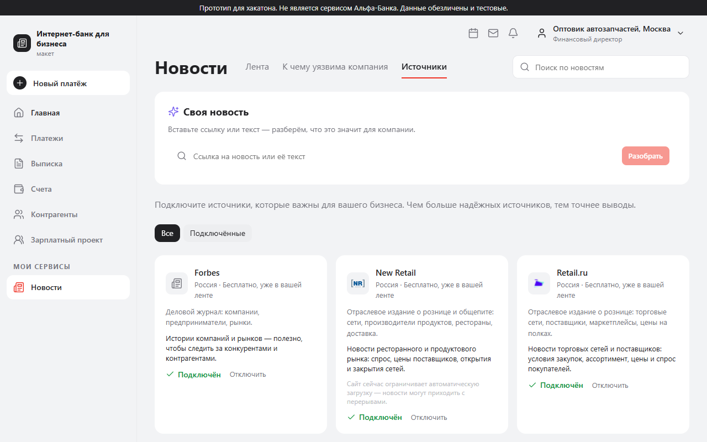

# Продукт: что умеет сервис и чем он полезен

Этот документ — про продукт, а не про код: для кого он, какие у него ключевые возможности, что мы выяснили в
исследованиях и как это изменило решение. Техническое описание — в [README](../README.md), метрики качества и
мониторинг — в [docs/metrics.md](metrics.md).

Скриншоты сняты на работающем стенде <https://alfanews.anyway-community.ru> под тестовой учёткой, окно 1280×800.
Компании в данных обезличены, все названия на экранах — «вид деятельности, город».

## 1. Коротко

У руководителя крупной компании новостей слишком много, а нужный ответ один: **«что это событие значит для нас и что
делать»**. Сервис встроен в интернет-банк как раздел «Новости». Он знает компанию по данным банка — отрасль, кредиты и
депозиты, внешнюю торговлю, группу компаний, платежи с покупателями и поставщиками — и для каждой новости говорит:

1. **важно ли это вам** — и насколько (важно / на контроле / к сведению);
2. **почему** — с цифрами из ваших данных: сколько компаний группы затронуто, какая доля платежей идёт этим
   поставщикам, есть ли у вас кредит;
3. **что делать** — два-три конкретных шага: кому поручить, к какому сроку, что проверить;
4. **что думает Альфа-Банк** — отдельным блоком, со ссылкой на материал, дату и страницу.

Сервис не пересказывает новости и не заменяет собственную аналитику клиента. Это не инвестиционная рекомендация,
и это написано на каждом экране.

## 2. Для кого

Для **действующих клиентов Альфа-Бизнеса — руководителей среднего, крупного и крупнейшего бизнеса**: собственника,
генерального директора, финансового директора, главного бухгалтера, казначея. У одной компании несколько пользователей,
и каждому важно своё: финдиректору — ставка и курс, главбуху — налоги и отчётность, казначею — валюта и размещение
свободных денег, собственнику — группа и госрасходы, гендиректору — покупатели и поставщики.

Крупный бизнес мы определяем **по выручке группы компаний** (больше 15 млрд ₽), как и организаторы кейса: в данных
341 такая группа, в них 13,6 тыс. компаний-клиентов. Масштаб самой компании и масштаб группы показываются вместе.
Меньшие компании не исключены: профиль строится для любой, просто у них меньше связей.

## 3. Чем мы отличаемся от ленты и от пересказа

| | Обычная лента | Пересказ нейросетью | Наш сервис |
|---|---|---|---|
| Что отбирает | по теме и популярности | всё подряд | **то, что задевает именно эту компанию и эту роль** |
| Ответ на «а мне что?» | нет | общие слова | цифры из данных компании: доля платежей, компании группы, свой кредит |
| Откуда связь | тема совпала | тема совпала | **и через контрагентов, и через группу**: новость о ресторанах доходит до поставщика ресторанов |
| Позиция банка | нет | смешана с выводами модели | **отдельный блок** с материалом, датой и страницей; если расходится с рынком — видно |
| Проверяемость | ссылка на источник | обычно нет | у каждого утверждения метка происхождения и источник; цитаты банка сверяются со страницей |
| Если данных не хватает | молчит | выдумывает | **честно пишет**, чего нет (например, «платежей меньше 5 % выручки — цепочку не строим») |
| Что дальше | — | — | шаги с адресатом и сроком, заявка менеджеру, переслать коллеге |

**Почему это может сделать именно банк.** Граф платежей между компаниями и продукты клиента есть только у банка.
Без них нельзя увидеть, что новость в чужой отрасли задевает вас через покупателей, а ставка — через кредиты ваших
компаний-соседей по группе.

## 4. Путь пользователя: 2–3 клика

1. **Главная банка.** Блок «Новости» стоит на главной и в меню «Мои сервисы». В нём — три главных события дня, у каждого
   одна строка «почему вам важно» и метка «Позиция банка», если у банка есть мнение.
2. **Клик по событию** — разбор: вывод сверху, почему, что делать, позиция банка.
3. **Клик по действию** — поручить, переслать коллеге или оставить заявку менеджеру с готовой темой.

Всё остальное — глубже, по желанию: «К чему уязвима компания», «Главное за неделю», «Как получен вывод»,
«Источники», поиск, «Своя новость».

## 5. Ключевые возможности

### Лента с выводом: «важно ли → почему → что делать»

Каждое событие в ленте — не заголовок, а вывод: уровень («Важно», «На контроле», «К сведению»), причина с числом из
данных компании и следующий шаг. Уровень один и тот же везде — в ленте за день, за неделю, в поиске и в самом разборе.
Ниже — все события по темам (налоги, ставка, курс, своя отрасль, внешняя торговля и логистика, спрос, рынок труда,
инфляция, события региона): это «другой разрез» для тех, кто хочет посмотреть шире. Событие, которое компанию не
касается, в ленту не попадает (оценка ниже порога), а шум — не деловые новости, чужие регионы — отсеивается заранее.

### Главное за день и за неделю

Переключатель «За день / За неделю» — короткий брифинг для руководителя. Неделя собрана из **сюжетов**: десять
новостей про одно решение ЦБ — один сюжет с подписью, сколько было новостей и когда пик, а не десять строк.
У сюжета есть состояние за неделю — например «Новое», «Держится», «Утих».

### Карта «К чему уязвима компания»

Для каждой компании сервис считает, **какие внешние факторы сильнее всего её задевают** — стоимость заёмных денег,
курс, спрос покупателей, цены поставщиков, внешняя торговля, рынок труда, госрасходы, инфляция — и **через что**:
собственный кредит, поставщики своей группы с внешней торговлей, покупатели из определённой отрасли. У фактора —
сила («сильно», «заметно», «слабо»), причина с числами, последнее событие и позиция банка по нему. Смена роли меняет
порядок факторов. Там, где вывод — оценка, а не данные (например, направление внешней торговли в данных банка не
указано), это написано рядом.

### Позиция банка — отдельно от вывода модели

В разборе позиция Альфа-Банка выделена цветом и подписью, с названием материала, датой и страницей: «Аналитики
Альфа-Банка · … · 11.09.2026 · стр. 1». Вывод модели помечен отдельно. Каждое утверждение несёт метку происхождения:
**факт** (из новости), **данные банка**, **позиция банка**, **вывод модели**, **гипотеза**, **оценка** (расчёт по
формуле), **предложение банка**. Если вывод модели расходится с позицией банка, рядом появляется предупреждение.
Если материала банка по теме нет — так и написано, чужая цитата «для вида» не подставляется.

### Проверка утверждений

Перед показом разбор проходит проверку, которую делает не модель, а программа: у фактов и позиции банка есть
источники, выдержка факта находится в тексте новости, цитата банка есть на указанной странице, цифры есть в данных
или источниках, суммы в рублях посчитаны по формуле, учтено не меньше двух факторов компании, роль отражена. То,
что не прошло проверку после доработки, убирается из разбора. В новости подсвечены места, на которые опирается
вывод, с номерами цитат.

### Разборы заранее

Разбор — это несколько шагов агента, он готовится десятки секунд. Поэтому лента, неделя и карта кэшируются и
прогреваются в фоне, а карточки верха ленты тестовых пользователей собираются **заранее** (прогрев перед проверкой):
открываешь — получаешь сразу. Разбор, которого ещё нет в кэше, собирается при первом открытии, с прогрессом по шагам.

### Роли

В шапке и на карте — переключатель роли (финдиректор, главбух, казначей, гендиректор, собственник). Роль меняет вес
факторов, порядок ленты и текст «почему важно» и «что делать»: факты и позиция банка — те же, акценты — свои.

### Действия и «Мои числа»

«Что делать» — нумерованные шаги. Под ними: «Поручить» (кому и к какому сроку), «Переслать коллеге», «Оставить заявку
менеджеру» — менеджер получает разбор и тему («структура долга»). Ничего не оформляется автоматически. Ниже —
«Спросить о разборе»: готовые вопросы («Сколько это в рублях?», «Что будет при ставке 12 %?», «Как это оценивает
Альфа-Банк?») и своя строка. **«Мои числа»** — поле, куда пользователь вводит свой долг или валютные закупки: сервис
считает рубли только на его числах и по явной формуле. Своих чисел нет — рублей нет, а не выдуманная сумма.

### Как получен вывод

Страница для тех, кто хочет проверить: что агент проверил (какие признаки компании, сколько материалов банка и
страниц, какие другие новости), **чего не нашёл**, прошла ли самопроверка и что она исправила, какие признаки компании
повлияли на вывод. Техника (шаги, модели, токены, стоимость) — внизу, свёрнуто, «для проверки».

### Источники и своя новость

Каталог источников: российские и зарубежные, отраслевые и деловые, бесплатные и по API; у каждого — что даст
подключение компании, можно подключить и отключить. Вверху — **«Своя новость»**: вставить ссылку или текст любой
свежей новости — сервис разберёт её для выбранной компании и роли. Это ответ на вопрос «что будет на новости, которой
нет в ваших данных». Текст новости агент читает как данные, а не как инструкции.

## 6. Исследования и как они повлияли на продукт

### 6.1. Разбор данных кейса

| Что выяснили | Как это изменило продукт |
|---|---|
| Крупный бизнес — это выручка **группы**, а не юрлица (ответ организаторов) | сегмент считается по группе; в профиле обе выручки и доля компании в группе; у сервиса есть блок «Ваша группа» |
| 81,7 % объёма платежей — переводы самому себе | они исключены из долей оборота и цепочек; внутригрупповой оборот считается отдельно |
| Выручка `1000` — заглушка (у 601 компании) | считается «нет данных», в суммы групп не входит |
| Платежи — одной суммой с 1 января, без дат; выручка — за 2025 год | доля платежей показывается как ориентир, а не точное покрытие; трендов и сезонности в данных нет — мы их не изображаем |
| Внешняя торговля — только страны, без направления | «импорт» и «экспорт» — оценка по отрасли, и она помечена как оценка |
| У контрагентов часто нет профиля | рядом с каждой долей — **покрытие** (у какой доли суммы отрасль контрагента известна); при покрытии меньше 30 % сила канала не выше низкой |
| Аналитика банка — сканы PDF без текста | материалы распознаются один раз (текст и таблицы разными способами) и хранятся постранично — иначе нельзя дать ссылку на страницу |
| Один из материалов («Российская сталь») — отчёт апреля 2021 года, а не нужный обзор сырья | помечен устаревшим и не используется как позиция банка |
| Материалы банка по ставке менялись во времени (13,5 % → 14,0 %) | агент берёт самый свежий и показывает дату материала |

### 6.2. Ответы организаторов

Требования, которые мы взяли в продукт: дисклеймер «не является инвестиционной рекомендацией»; явное разделение
фактов, выводов модели и гипотез; предупреждение, когда модель расходится с банком; шкала значимости с определёнными
уровнями; действия после разбора (менеджер, заявка, переслать); учётки для проверки и выбор роли; заметная точка
входа на главной.

### 6.3. Проход по ролям (25.10)

Мы прошли сервис без инструкции четырьмя сценариями — по одной роли и компании: собственник топливного холдинга,
финансовый директор оптовика автозапчастей, казначей зернотрейдера, гендиректор поставщика общепита. В каждом —
по два разбора и два вопроса. Что понравилось всем: карта «К чему уязвима компания», честность («без ваших цифр расчёт
был бы выдумкой»), метки происхождения, «Что делать» как чек-лист, подсветка цитат в новости, отсев «не касается вас».

Что нашли — и что исправили:

| Находка | Что сделали |
|---|---|
| Цитата банка не по теме (в разборе нефти и курса — цитата про ставку) | цитата показывается, только если совпадает тема; иначе «позиции банка по теме нет»; устаревшая — с датой |
| Устаревшие даты: «следите за заседанием 23 октября» 25 октября | агент знает сегодняшнюю дату и не предлагает «следить» за прошедшим |
| Числа и метки расходятся: «затронуто 48 / 18 / 18», «Важно» в ленте и «Следить» в карточке | одно определение охвата («затронуто N из K других компаний группы, из них с кредитом M») и **один уровень события** во всех экранах |
| Компании названы «Компания №92457», «U_34961»; служебные id и имена функций на экранах | компании называются видом деятельности и ролью с долей; в «Как получен вывод» сверху — человеческое резюме, техника свёрнута |
| Действия без адресата: «уточните у казначейства» | шаги с адресатом, сроком и под роль |
| Поиск падал на запросе «пошлина» | исправлено |
| Рубли только «на каждый 1 млрд долга», поля для своих чисел нет | сценарии на условных числах и поле «Мои числа» с пересчётом |
| Для перепродавца «рост нефти поддержит выручку» при сжатии маржи | в разборе учитывается маржа перепродажи |
| Новость привязана к фактору не по смыслу (ипотека → «стоимость заёмных денег»; бензин → «санкции») | привязка по смыслу, исключения и тесты |
| Лента не про отрасль: у общепита нет новостей о ценах на продукты, у зернотрейдера — о пошлинах | добавлены отраслевые источники и темы общепита и зерна |
| Дубли «Важно: Важно:», «Главное» и «События» показывают одно и то же | лента без дублей, счётчики совпадают |
| Поле вопроса внизу страницы, под статьёй | вопрос под выводом, готовые подсказки с цифрами |
| «Источники»: нет «Отключить» и «что даст подключение» | добавлены |

Что **осталось** (честно): первая сборка разбора, которого нет в кэше, занимает десятки секунд — минуты; на
шлюзе моделей бывают сбои и повторы; отраслевых новостей для некоторых отраслей по-прежнему меньше, чем для
универсальных (подробнее — в [docs/metrics.md](metrics.md), раздел «Известные ограничения»).

## 7. Преимущества

- **Персональный вывод вместо ленты.** Одно и то же событие для двух компаний и двух ролей даёт разные выводы:
  ставка 14 % для оптовика автозапчастей с кредитом и для топливного холдинга читается по-разному — через их
  собственные данные (кредиты группы, доли платежей, депозит). Сравнить можно на стенде двумя учётками.
- **Связь через контрагентов и группу** — то, что невозможно без данных банка.
- **Банк и модель различимы с первого взгляда**, а цитаты банка проверяются по странице.
- **Честность**: нет данных — так и написано; нет позиции банка — так и написано; оценка помечена оценкой.
- **Проверяемость**: у каждого разбора есть страница «Как получен вывод» со всеми признаками, источниками и проверками.
- **Работает на новых новостях**: «Своя новость» разбирает любой текст или ссылку, а не заготовки.
- **Расширяется настройкой**: новые источники, отрасли, факторы и веса ролей — файлы конфигурации, а не код
  (см. [README](../README.md)).
- **Укладывается в бюджет**: тяжёлые шаги делаются один раз на новость, разборы кэшируются, есть суточный стоп-кран.

## 8. Чего сервис не делает

- Не даёт инвестиционных рекомендаций и не оформляет сделки: заявка менеджеру — это передача разбора человеку.
- Не оценивает суммы без исходных данных: долг и валютные закупки клиента банк в данных не хранит, поэтому рубли —
  на «Моих числах» пользователя или на явных условных сценариях.
- Не показывает тренды платежей: в выгрузке нет дат.
- Мобильная версия не делалась: интерфейс рассчитан на экран банка.
